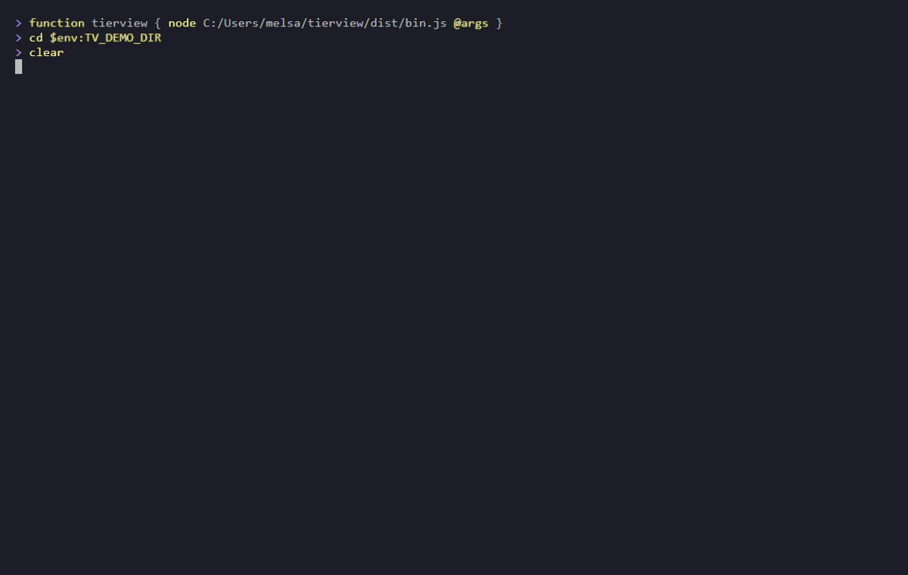
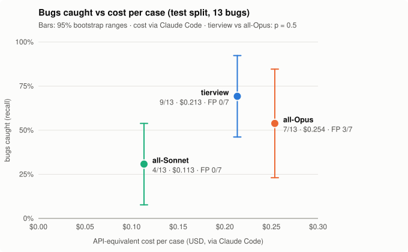

<div align="center">

# tierview

**Tiered Claude code review with a cost receipt**

Caught 9 of 13 real bugs vs 7 for all-Opus, with zero false alarms, at 16% lower cost.<br>
<sub>(13 held-out bugs, not statistically significant; see <a href="bench/results/RESULTS.md">RESULTS.md</a>)</sub>



<sub>`tierview review --dry-run` on the 4-file change in <a href="demo/make-sample-repo.mjs"><code>demo/</code></a>: it shows where every hunk would go and what the review would cost, with zero model calls. Recorded with <a href="demo/demo.tape">VHS</a>.</sub>

</div>



## What it does

tierview reads a diff, scores each hunk for risk with deterministic rules (auth, SQL, memory, concurrency, boundary changes and so on), and sends it to the cheapest Claude model that can handle it: boring hunks to Sonnet 5.5 at low effort, risky ones to Opus 5.5. When a model is unsure, contradicts itself or reports something serious, the hunk goes up a tier for a second look, and a higher tier can refute a lower tier's finding. At the end it prints a **cost receipt**: tokens and cost per tier, and what the same work would have cost on the most expensive model.

### A real receipt

This is a saved run from the benchmark ([`django-lookup-rhs-iterator__tierview.json`](bench/results/runs/django-lookup-rhs-iterator__tierview.json)), a Django commit whose later fix says it consumed iterator right-hand sides. tierview caught it. The explanation is shortened here; the receipt is as printed.

```text
tierview: 1 finding(s) in 4 reviewed hunk(s).

[medium] django/db/models/lookups.py:290-304  self.rhs iterated twice; one-shot iterables (generators) lose values
  bug, confidence 0.45, tier 3 claude-opus-5-5
  If rhs is a one-shot iterator, any() uses it up and the loop then gets nothing, so the
  In lookup matches nothing and the query silently returns no rows. (shortened)
  fix: Turn the iterable into a list once before checking it, e.g. `rhs = list(self.rhs)`.

Receipt (claude-code backend: 2 claude call(s); cost is API-equivalent at list prices as of 2026-11-16, not what your plan bills)
  tier  model              effort  hunks  +escalated  calls  input  cache write  cache read  output  via Claude Code  direct API
  1     claude-sonnet-5-5  low         3           0      1      2       13,900         994     297            $0.06       $0.03
  2     claude-opus-5-5    medium      0           0      0      0            0           0       0            $0.00       $0.00
  3     claude-opus-5-5    high        1           0      1      2        6,406         994   4,315            $0.14       $0.11

  total:                $0.20 via Claude Code, $0.14 direct API (without Claude Code's per-call overhead) (26,910 tokens)
  all-claude-fable-5-2: $0.51 via Claude Code, $0.33 direct API (the same tokens at its rates) -> 61.5% less
  skipped hunks: 0   not reviewed: 0   wall time: 62.4s
  Tier 3 ran on Opus 5.5 (Fable not enabled)
```

The all-Fable line is a **calculation** (this run's tokens priced at Fable 5.2 list rates), not a measurement: no Fable call was made, and a real all-Fable run would send different tokens. On a Claude plan the dollar figures are API-equivalent; the plan billed nothing extra.

## Install

### Free path: your Claude subscription, no API key

tierview's default backend runs the official [Claude Code](https://code.claude.com) CLI (`claude -p`) once per batch of hunks, so it uses the plan you already pay for. It never reads or copies Claude Code's login; it only runs the binary.

```bash
# 1. Install and sign in to Claude Code (once): https://code.claude.com
# 2. Then, in any git repo with changes:
npx tierview review --dry-run     # free: zero model calls, shows routing and an estimate
npx tierview review               # the real review, on your plan
```

Or install it: `npm install -g tierview`. Needs Node 22 or newer.

Plans have usage limits. The benchmark ran 190 calls on a Pro plan in batches of at most 20 and still hit the 5-hour limit once (see [RESULTS.md](bench/results/RESULTS.md)). `--max-calls <n>` and `--max-cost <usd>` cap a run, and a capped run says exactly which hunks it left unreviewed (exit code 3).

### With an API key

```bash
export ANTHROPIC_API_KEY=...
npx tierview review --backend api
```

The `api` backend bills your key at list prices. It is unit-tested against a mocked SDK; it has not been run live.

## How the tiers work

```text
 diff
  |
  v
 Tier 0  parse hunks, score risk with rules (free, no model)
  |        generated files (lockfiles, dist/) are skipped
  |
  +-- score < 25 -------> Tier 1  Sonnet 5.5, low effort
  +-- score 25 to 59 ---> Tier 2  Opus 5.5, medium effort    (with Fable off, Tiers 2
  +-- score >= 60 ------> Tier 3  Opus 5.5, high effort       and 3 run as one Opus call)

 Tier 1 hunk goes up when: confidence < 0.7, the model asks for help,
 it reports a high-severity finding, it contradicts itself, or the call fails.
 A higher tier verifies or refutes lower-tier findings, then:
  v
 merge duplicates, rank by severity, print findings + cost receipt
```

Routing costs nothing and is inspectable: `--dry-run` prints the points behind every hunk's tier (for example `auth +35, sql +30, boundary +25`). Weights and thresholds are data in [`config/default-rules.yml`](config/default-rules.yml); every key is in [docs/CONFIG.md](docs/CONFIG.md).

### Fable is opt-in

On some Claude plans, Fable 5.2 uses paid extra usage, and `claude -p` does not ask before using it. So on the default backend tierview never requests Fable unless you ask:

```bash
tierview review --allow-fable      # or allowFable: true in .tierview.yml
```

With the flag it prints a warning before the first call. Without it, Tier 3 runs on Opus 5.5 and the receipt says so. **Fable was never measured in the benchmark**, so nothing here supports a claim about its quality.

### `--dry-run`

`tierview review --dry-run` makes zero model calls. It prints each hunk's score, tier and reasons, an estimated cost per tier, the all-Fable comparison and the savings estimate (see the GIF above). The token estimates are rough placeholders calibrated on a handful of runs; treat the dollar figures as an order of magnitude.

## Other ways to run it

```bash
tierview review --staged                  # staged changes only
tierview review --base main --head HEAD   # a range
tierview review --diff-file change.diff   # a saved diff (no file context)
tierview review --json --sarif out.sarif  # machine-readable output
tierview review --fail-on high            # exit 1 on findings at or above high
tierview pr https://github.com/OWNER/REPO/pull/123 --dry-run   # a pull request (set GITHUB_TOKEN)
```

### GitHub Action

[`examples/tierview.yml`](examples/tierview.yml) is a ready workflow. Add your own `ANTHROPIC_API_KEY` as a repository secret; the Action reviews each pull request on the API backend, posts one summary comment (findings and receipt, updated in place) and stops at `max-cost` (default $2.00 per run). Fork PRs, which get no secrets, are skipped with a notice.

**Not tested live yet.** The Action and its PR comment have been tested only with mocked GitHub responses. They have not run on a real runner against a real PR. CI for this repo runs the typecheck, the tests, the build and a packed-package smoke test on Ubuntu, Windows and macOS with Node 22 and 24, and all of that is green, but that is not the same as the Action working end to end. Treat the first runs as a trial and [open an issue](https://github.com/moelsaka01/tierview/issues) if it breaks.

## Benchmark

On a held-out test split of **13 buggy and 7 clean commits** from 9 open-source repos (QEMU, DPDK, Django, Cilium, Tetragon, Firecracker, Next.js and others), each run once per arm on the `claude-code` backend. The bugs are real: each commit introduced a bug that a later commit fixed and named. Config frozen before the test run (tag `bench-config-v2`).

| arm | bugs caught (95% range) | clean cases with a false alarm | cost per case via Claude Code | cost per bug caught |
|---|---|---:|---:|---:|
| **tierview** | **9 / 13 = 69%** (46–92%) | **0 / 7** | $0.213 | $0.364 |
| all-Opus | 7 / 13 = 54% (23–85%) | 3 / 7 | $0.254 | $0.525 |
| all-Sonnet | 4 / 13 = 31% (8–54%) | 0 / 7 | $0.113 | $0.408 |

### What this does and does not show

- **The difference is not statistically significant.** tierview caught 2 bugs all-Opus missed; all-Opus caught none that tierview missed. Exact McNemar p = 0.5. The 95% ranges overlap for every pair of arms. This is a pilot, not proof.
- **n = 13.** And C-heavy: 7 of the 13 test bugs are C (QEMU, DPDK); TypeScript has one. It says little about other languages.
- **tierview cost about 1.9x all-Sonnet.** It is not the cheapest arm, only the cheapest of the two that caught most bugs.
- **One run per case and arm.** Models vary between runs; single runs cannot measure that.
- **The clean set is older and calmer** (2025 commits with no fix touching them for a year), so false-alarm rates may be optimistic.
- **The judge is mine to audit, not independent.** A rule plus an Opus fallback decides whether a finding matches the known bug. I hand-checked 20 judgements: 14 agree, 0 disagree, 6 unsure. The marker was the author.
- **The dev split disagreed on all-Sonnet** (it looked best there), which is why the test split is the headline and dev was used only for tuning.
- **No Fable arm.** Costs for Fable are calculated, not measured.

Everything, including every case, the raw runs, the judgements and a usage-limit incident that was found and fixed before any metric was computed, is in [bench/results/RESULTS.md](bench/results/RESULTS.md). Reproduce with `npm run bench:build` and the commands at the bottom of that file (the full run is 190 `claude` calls).

## How it compares

Facts as checked on 2026-11-16; products change, so check their pages.

| | routes by | escalates | cost shown | published benchmark of the router | license |
|---|---|---|---|---|---|
| **tierview** | each hunk, with deterministic rules | yes, on confidence, contradiction and severity | per-tier receipt with an all-Fable counterfactual | yes, small (this repo) | MIT |
| [d1ff](https://github.com/d1ff-dev/d1ff) | each change into simple / medium / complex model tiers | not found | not found | has a `benchmark/` directory, no results found | MIT |
| OrcaCode Review | cheap model screens, strong model does a final pass | not found | not found | not found | not checked |
| Qodo (PR-Agent core is Apache-2.0) | review depth per PR, chosen by a small LLM classifier | not found | not found | not found | commercial product; open core |
| CodeRabbit | closed | not found | per-seat pricing | not found | closed |

Tiered routing on its own is not new, and tierview is not the first tiered reviewer. What I did not find elsewhere is confidence-based escalation between tiers, a cost receipt with a counterfactual, and a published ground-truth benchmark of the router against single-model baselines. "Not found" means I did not find it in two searches and two page reads, not that it does not exist.

## FAQ

**Is it really free?** There is no tierview fee and no API key on the default path; it spends your existing Claude plan's usage. `--dry-run` spends nothing. A real review makes about 2 `claude` calls (1.9 on average in the benchmark), and plans have limits.

**Does it send my code anywhere?** To Anthropic, through Claude Code (or the API, with `--backend api`), exactly as if you pasted the diff into Claude. tierview itself has no server and sends nothing else. On the default backend the `claude` process runs in an empty temp directory in safe mode, so the reviewed repo's CLAUDE.md, hooks and MCP servers never load.

**Why not just use the best model on everything?** You can: the all-Opus arm is that. On this small test it cost 16% more per case and was no better (7 vs 9, within noise) and raised false alarms on 3 of 7 clean commits. With 13 bugs, I cannot tell you that the cascade is better, only that I did not see it be worse.

**Does the cost receipt show what I was billed?** On a plan, no: it is the API-equivalent cost of the tokens that ran, at the list prices in [`config/prices.json`](config/prices.json) (with an `as_of` date). Your plan billed nothing extra. On `--backend api` it is what your key was charged at list prices.

**Can I make it review more or less carefully?** Yes: `.tierview.yml` sets thresholds, per-path `min_tier` and `max_tier`, signal weights and models. See [docs/CONFIG.md](docs/CONFIG.md). Weights and thresholds were tuned on the 10-case dev split only.

**What does it miss?** 4 of the 13 test bugs, 3 C and 1 Rust: an int overflow, an ignored PTE bit, an address-space layout problem and a thread-startup race. A bug in a boring-looking hunk gets Sonnet at low effort; escalation is the mitigation, not a guarantee.

**Which Claude models does it use?** Sonnet 5.5 and Opus 5.5 by default, Fable 5.2 only if you opt in. The IDs are in `config/default-rules.yml`.

## Development

```bash
npm install
npm run check      # typecheck + tests (no network, no model calls)
npm run build
```

[PLAN.md](PLAN.md) is the design spec and [BUILD_LOG.md](BUILD_LOG.md) records how it was built, including what went wrong. [CHANGELOG.md](CHANGELOG.md) lists releases. Ideas for a hosted version are in [docs/HOSTED.md](docs/HOSTED.md) (not built).

MIT licensed.
