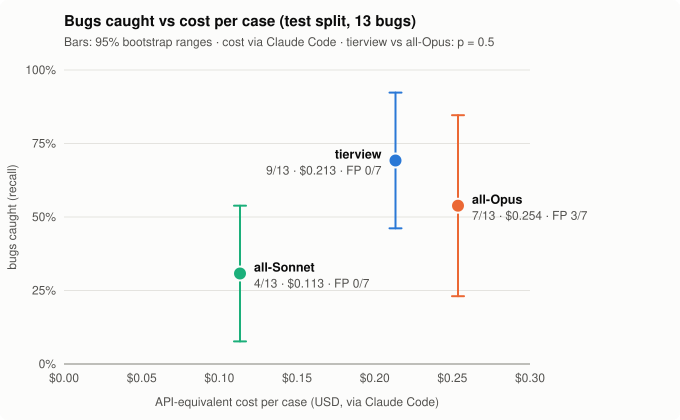

# tierview benchmark results

**On the 13-bug test split, tierview caught more bugs than all-Opus (9 vs 7) with zero false alarms, at 16% lower cost per case.** The difference in bugs caught is **not statistically significant** (exact McNemar p = 0.5, n = 13), and the dataset is small and C-heavy. Read every number below with its range.



## Test split (the headline)

13 buggy and 7 clean cases, frozen config `bench-config-v2` (git tag; config hash `4fe1abf9f1f3`), run once per (case, arm) on the `claude-code` backend.

| arm | bugs caught (recall, 95% range) | clean cases with a false alarm | claude calls per case | cost per case via Claude Code | cost per case, direct API | cost per bug caught (via Claude Code / direct API) |
|---|---|---:|---:|---:|---:|---|
| **tierview** | **9 / 13 = 69%** (46–92%) | **0 / 7** | 1.9 | $0.213 | $0.137 | $0.364 / $0.241 |
| all-Opus | 7 / 13 = 54% (23–85%) | 3 / 7 | 1.1 | $0.254 | $0.148 | $0.525 / $0.308 |
| all-Sonnet | 4 / 13 = 31% (8–54%) | 0 / 7 | 1.1 | $0.113 | $0.060 | $0.408 / $0.218 |

- **tierview vs all-Opus:** both caught 7 bugs; tierview alone caught 2 (Cilium MTU warning, Django lookup iterator); all-Opus alone caught none; neither caught 4. Exact McNemar p = 0.5: with 2 discordant cases out of 13, this is consistent with no real difference.
- **Cost:** tierview was 16% cheaper per case than all-Opus via Claude Code ($0.213 vs $0.254) and 7% cheaper on the direct-API basis ($0.137 vs $0.148). It cost about 1.9x all-Sonnet.
- **False alarms** (findings of medium severity or higher on a clean case): all-Opus raised one on 3 of 7 clean cases; tierview and all-Sonnet on none.
- **Calculated all-Fable cost: $0.507 per case via Claude Code, $0.295 direct API.** This is **calculated, not measured**: the all-Opus arm's actual tokens priced at Fable 5.2 list rates. No Fable call was made (see "What was not measured").
- Routing: 9 of the 13 faulty hunks were routed to Opus by the deterministic rules; tierview escalated 3% of hunks.
- Mean tokens per case: tierview 35,142, all-Opus 29,174, all-Sonnet 27,828 (tierview's Tier 1 carries file context and most cases also make an Opus call).

### Per case (test split)

Cost is API-equivalent via Claude Code for that run.

| case | language | bug (from the fix) | tierview | all-Sonnet | all-Opus |
|---|---|---|---|---|---|
| ch-prefault-thread-startup | Rust | Prefault workers are released before their threads finish starting up, a race that makes large prefaults up to 4x slower. | missed ($0.334) | missed ($0.158) | missed ($0.351) |
| cilium-mtu-portmap-warning | Go | The new route-MTU warning fires wrongly with portmap chaining, where cilium-cni still sets the route MTU. | **caught** ($0.134) | missed ($0.053) | missed ($0.124) |
| django-jsonfield-in-value-none | Python | JSONField __in lookups crash on SQLite when the right-hand side holds Value(None) expressions. | **caught** ($0.214) | missed ($0.046) | **caught** ($0.127) |
| django-lookup-rhs-iterator | Python | get_prep_lookup() consumes iterator right-hand sides in annotation lookups, so the query sees an empty list. | **caught** ($0.196) | missed ($0.081) | missed ($0.204) |
| dpdk-hws-counter-double-free | C | The counter pool name is freed on the create error path and again on destroy (double free). | **caught** ($0.124) | **caught** ($0.052) | **caught** ($0.124) |
| dpdk-mem-fbarray-placement | C | Reserving all VA space in one go places the first fbarray right after the memseg lists, which crashes secondary processes. | missed ($0.579) | missed ($0.217) | missed ($0.541) |
| dpdk-procinfo-eeprom-loop | C | The EEPROM dump stops at the first port whose module EEPROM cannot be read, hiding all later ports. | **caught** ($0.241) | missed ($0.139) | **caught** ($0.287) |
| nextjs-devtools-touch-action | TypeScript | Removing `touch-action: none` from the draggable devtools indicator breaks dragging on touch screens. | **caught** ($0.180) | **caught** ($0.121) | **caught** ($0.250) |
| qemu-colo-visitor-width | C | The max_queue_size setter uses a uint64 visitor for a uint32_t field, accepting values that do not fit. | **caught** ($0.144) | **caught** ($0.073) | **caught** ($0.180) |
| qemu-loongarch-pte-nr | C | The PTE NR (not readable) bit is ignored, so write-only pages are exposed as readable. | missed ($0.062) | missed ($0.062) | missed ($0.140) |
| qemu-nbd-block-status-assert | C | A non-compliant NBD client can trigger an assertion (server crash) by sending BLOCK_STATUS without negotiated metacontexts. | **caught** ($0.640) | missed ($0.456) | **caught** ($0.951) |
| qemu-vmdk-int-overflow | C | cluster_bytes and buf_bytes are int, which overflows for the largest allowed cluster size. | missed ($0.250) | missed ($0.102) | missed ($0.238) |
| tetragon-domains-output-format | Go | `tetra tracingpolicy domains` accepts unsupported output formats, prints nothing and exits successfully. | **caught** ($0.183) | **caught** ($0.071) | **caught** ($0.159) |
| cilium-clean-wireguard-margin | Go | clean | 0 FP ($0.051) | 0 FP ($0.051) | 0 FP ($0.107) |
| django-clean-keytexttransform-mysql | Python | clean | 0 FP ($0.110) | 0 FP ($0.042) | **1 FP** ($0.119) |
| django-clean-migration-determinism | Python | clean | 0 FP ($0.161) | 0 FP ($0.070) | 0 FP ($0.149) |
| dpdk-clean-dpaa2-prefetch | C | clean | 0 FP ($0.221) | 0 FP ($0.112) | **1 FP** ($0.260) |
| firecracker-clean-balloon-error | Rust | clean | 0 FP ($0.057) | 0 FP ($0.057) | **1 FP** ($0.126) |
| firecracker-clean-pci-prog-if | Rust | clean | 0 FP ($0.232) | 0 FP ($0.233) | 0 FP ($0.474) |
| nextjs-clean-head-ppr-resume | TypeScript | clean | 0 FP ($0.155) | 0 FP ($0.070) | 0 FP ($0.162) |

## Dev split (tuning data, not the headline)

7 buggy and 3 clean cases, used to tune routing and to decide `bench-config-v2` (Tier 1 gets Tier 3's file context). Final dev numbers on `bench-config-v2`:

| arm | bugs caught | clean cases with a false alarm | cost per case via Claude Code | cost per case, direct API |
|---|---|---:|---:|---:|
| tierview | 5 / 7 = 71% (43–100%) | 0 / 3 | $0.161 | $0.130 |
| all-Sonnet | 5 / 7 = 71% (43–100%) | 0 / 3 | $0.111 | $0.060 |
| all-Opus | 5 / 7 = 71% (43–100%) | 0 / 3 | $0.254 | $0.155 |

**The dev and test splits disagree on all-Sonnet.** On dev it caught as many bugs as all-Opus at the lowest cost (5 of 7); on test it caught 4 of 13, the fewest. On dev, the cheapest arm looked best; on test, it did not. Seven dev bugs were too few to predict the test result, which is why the test split is the headline and why the dev split was used only for tuning.

## How it was measured

- **Cases** (`bench/cases/`, listed in `bench/cases/README.md`): 30 commits from 9 open-source repos. 20 introduced a bug that a later commit fixed and named it (`Fixes: <sha>`, "Regression in <sha>", "regression from #PR"); `git blame` confirms the fix rewrote lines of the bug commit. All fixes are from 2026-08-23 to 2026-11-13. 10 are presumed-clean commits from 2025 with no fix touching their lines for 12 months. Split: 10 dev (7 buggy), 20 test (13 buggy).
- **Arms:** `tierview` (Sonnet 5.5 low for low-risk hunks, then one Opus 5.5 high call for risky and escalated hunks; Fable off), `all-sonnet` (every hunk to Sonnet 5.5 low with Tier 3 context), `all-opus` (every hunk to Opus 5.5 medium with Tier 3 context). Same prompts and output schema.
- **Judge:** a rule first: a finding within 3 lines of a line the fix changed is a catch; for fixes spread over more than 8 lines it must also name at least 2 terms of the bug's mechanism. Findings the rule cannot decide go to Opus 5.5 (medium), blind to arm and model. Every judgement is in `judgements.jsonl`. A hand audit of 20 judgements (stratified across rule matches, model matches and no-matches) is in `judge-audit.csv`, marked by the author: **14 agree, 0 disagree, 6 unsure; agreement 100% of the 14 decided (70% of all 20).** Six unsure marks mean the judge is not proven on hard cases; the audit sample is small and the marker is the author, not an independent reviewer.
- **Costs:** "via Claude Code" is the API-equivalent cost of the tokens that actually ran through `claude -p` (list prices, `config/prices.json`, as of 2026-11-16); it is not what the Claude plan billed ($0). "Direct API" removes Claude Code's ~2,100-token per-call overhead and prices the rest at the uncached input rate.
- **Confidence ranges:** percentile bootstrap, 2,000 resamples. **Significance:** exact two-sided McNemar on paired buggy cases.

## Limitations

- **Small n.** 13 test bugs; the 95% ranges overlap for every pair of arms. These are pilot-scale results, not proof.
- **C-heavy mix.** 7 of the 13 test bugs (and 10 of all 20) are C code from QEMU and DPDK; TypeScript has 1 test bug. Results say little about other languages.
- **Clean set is older and calmer.** Clean commits are from 2025, and commits whose files saw many later fixes were skipped, so false-alarm rates may be optimistic.
- **One run per (case, arm).** Model answers vary between runs (the pilot showed the same input caught in one run and missed in the next); single runs cannot measure that variance.
- **Tuning saw the test bug list.** Routing and `bench-config-v2` were decided on the dev split only, and no test diff was routed or reviewed before freezing, but the person tuning had read the one-line descriptions of the test bugs while building the dataset.
- **Judge.** The rule can accept a finding that sits on the faulty lines but describes a different problem; the wide-fix term check and the Opus fallback reduce this. The 20-judgement hand audit found no disagreement (14 agree, 6 unsure), but it is small, was marked by the author, and the 6 unsure cases are unresolved.
- **Churn signals off.** Cases were reviewed from saved diffs, so git-history signals were off in every arm.
- **Unmatched findings are not false alarms.** On buggy cases, findings that do not match the known bug are counted separately (tierview 1.08 per case, all-Opus 0.85, all-Sonnet 0.38); some are real other bugs (for example the second fix of the DPDK NTB commit).

## What was not measured

- **Fable 5.2.** No Fable call was made (on some plans Fable uses paid extra usage, and there was no budget for it). The all-Fable figure above is **calculated** from all-Opus tokens at Fable rates; a real all-Fable run would send different tokens. The planned `all-fable-low` arm was dropped. Nothing here supports a claim about Fable-level quality.
- **Latency as API latency.** Wall times (tierview p50 41 s, p90 85 s; all-Opus 29 / 44 s; all-Sonnet 17 / 23 s) include Claude Code start-up.

## Usage, and the batch 3 incident

The benchmark ran on a Claude Pro plan through Claude Code in 11 batches of at most 20 `claude` calls: 190 calls in all (171 reviews, 19 Opus judge calls), about $20.36 API-equivalent, $0 billed. Every call is in `usage.jsonl`, every batch in `batches.jsonl`.

**Test batch 3 hit the plan's 5-hour usage limit mid-batch.** Claude Code answered "You've hit your 5-hour limit · resets …", which the runner's limit pattern did not recognise, and runs whose calls had failed were still saved as complete: 10 runs (9 with zero tokens) would have counted as reviewed, and the clean ones as "no false alarms". It was found when the batch was checked, before any metric was computed. **Fix:** the runner now recognises that wording, treats any run with a failed call as incomplete and stops the batch, and stops on a failed judge call. Every saved run was scanned (failed calls appeared only in that batch); the 10 runs were marked incomplete and re-run in test batch 4. All 90 runs in these results completed without a failed call.

## Reproduce

```bash
npm install && npm run bench:build
node .bench-build/run.js --cases test --dry-run   # plan a batch, zero calls
node .bench-build/run.js --cases test             # one batch, at most 20 claude calls
node .bench-build/metrics.js --split test         # tables and results-test.json
node .bench-build/chart.js                        # chart.svg
node .bench-build/audit.js --score                # agreement rate once judge-audit.csv is marked
```

Raw data: `runs/` (one review per case and arm), `runs-archive/` (superseded runs), `judgements.jsonl`, `usage.jsonl`, `batches.jsonl`, `results-test.json`, `results-dev.json`. Build history and every decision: `BUILD_LOG.md`, Phase 4.
